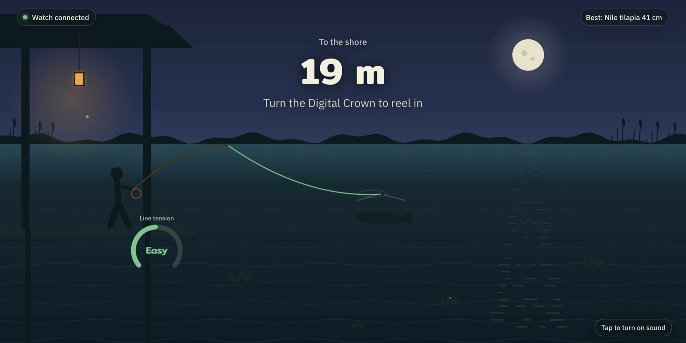
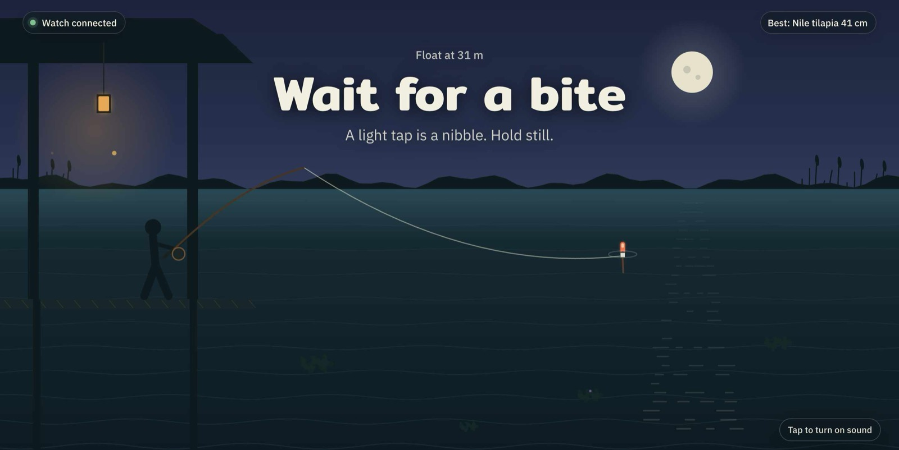
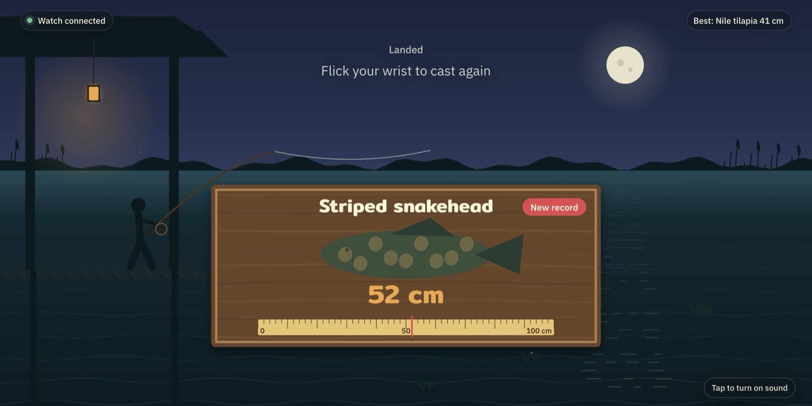

# Watch Fishing

Night fishing on your Mac screen, played with your Apple Watch. Flick your wrist to cast, feel the nibble on your wrist, jerk to hook, and turn the Digital Crown to reel in.



The game logic and sensors run on the watch, so haptics stay in sync with your hand. The Mac only draws what the watch reports, with a canvas scene of a riverside pavilion at night.

| Waiting for a bite | Landed a snakehead |
|---|---|
|  |  |

## How to play

1. Flick your wrist forward to cast. A harder flick sends the float further, and bigger fish live further out.
2. A light tap on the wrist is a nibble. Hold still.
3. A strong buzz and the float sinks: flick your wrist up within 1.5 seconds to hook it.
4. Turn the Digital Crown to reel in. When the fish pulls (a downward buzz, orange text on screen), stop reeling or the line snaps.
5. After a catch or a miss, flick your wrist again to cast the next round.

Fish you can catch: silver barb, Nile tilapia, walking catfish, striped snakehead, barramundi, giant snakehead, Mekong giant catfish, and the occasional flip-flop.

## Requirements

- Mac with Xcode 27 or later, and [XcodeGen](https://github.com/yonaskolb/XcodeGen) (`brew install xcodegen`)
- Apple Watch on watchOS 27, paired to an iPhone on iOS 27. With watchOS 26, Device Hub could not find the watch at all in my testing.
- Python 3 on the Mac (standard library only)

## Setup

1. Pair the watch with your Mac: open Device Hub (inside Xcode), click **+**, choose **Pair Nearby Device**, and turn on Developer Mode on the iPhone and the watch when asked (Settings > Privacy & Security > Developer Mode).
2. Change the bundle ID in `project.yml` (`PRODUCT_BUNDLE_IDENTIFIER`) and the `BUNDLE` constant in `mac/server.py` to your own, then generate the project with your team ID:

   ```sh
   DEVELOPMENT_TEAM=<your team id> xcodegen generate
   ```

   Your team ID is in Xcode > Settings > Apple Accounts. A free Personal Team works, but the app expires after 7 days and must be reinstalled.
3. Build and run the `WatchFishing` scheme on your watch from Xcode once.
4. Start the bridge and open the page:

   ```sh
   python3 mac/server.py
   open http://localhost:8765
   ```

   The bridge launches the game on the watch for you. Raise your wrist so the watch screen is on when it starts.

To try the screen without a watch, open `http://localhost:8765/?demo=1`, or freeze one state with `?demo=ready|waiting|bite|fighting|caught|lost|offline`.

## How the watch talks to the Mac

The watch could not reach the Mac over the home Wi-Fi with plain HTTP (every request timed out, likely because watch traffic goes through the iPhone). So the bridge uses the developer connection that Xcode already has:

- `mac/server.py` starts the app with `xcrun devicectl device process launch --console`
- the watch prints one `STATE {json}` line about 15 times a second
- the server forwards each line to the page with Server-Sent Events

This only works while the watch is paired for development. If the watch goes quiet for 8 seconds, the server relaunches the game.

## Project layout

```
FishingWatch/FishingCore.swift  game rules, no WatchKit, testable on the Mac
FishingWatch/GameModel.swift    motion, haptics, Digital Crown, state output
FishingWatch/FishingApp.swift   watch UI
mac/server.py                   devicectl bridge + SSE server
mac/index.html                  canvas game screen
Tests/main.swift                self-check for the game rules
```

Run the game rule tests on the Mac:

```sh
swiftc FishingWatch/FishingCore.swift Tests/main.swift -o /tmp/fishtest && /tmp/fishtest
```

## Known limits

- Reel speed (`reelPerCrown`) and the flick thresholds are first guesses and still need tuning on real hands.
- Needs a Mac with developer tools nearby. It is not an App Store app.

## License

MIT
